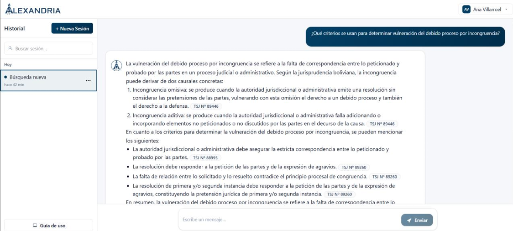
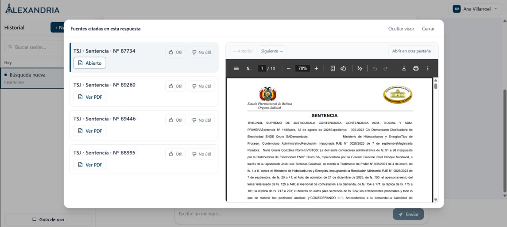

# Alexandria — Frontend

React-based web application for **Alexandria**, an AI-powered legal research assistant developed for the Bolivian legal system.

The interface provides legal professionals with a conversational research experience, access to supporting court decisions, session history, and tools for evaluating the relevance of retrieved documents.

## Tech Stack

- **React** — Component-based user interface
- **JavaScript** — Client-side application logic
- **REST APIs** — Integration with Django REST Framework
- **JWT Authentication** — Authenticated access to backend services
- **Jest** — Frontend unit testing

## Features

### AI-Powered Legal Research

A conversational interface that allows users to submit legal questions in natural language and receive AI-generated responses grounded in retrieved legal sources.

- Natural-language queries
- Evidence-based responses
- Citations to relevant legal documents
- Integrated retrieval results

### Legal Document Viewer

An integrated PDF viewer allows users to inspect the original documents referenced in generated answers.

- View cited court decisions
- Navigate between retrieved sources
- Inspect supporting legal evidence
- Access document references without leaving the research workflow

### Authentication & User Management

The frontend integrates with the backend's authentication and authorization services.

- Login and registration
- Email OTP verification
- Password recovery
- JWT-based authentication
- Administrator interface for whitelist management
- Role-dependent access to application features

### Research Session History

Users can organize and revisit previous research sessions.

- Create new research sessions
- Browse previous sessions
- Return to earlier queries
- Continue reviewing retrieved information

### Relevance Feedback

Users can evaluate retrieved results to help improve the research experience.

- Mark results as useful or not useful
- Submit relevance feedback
- Support the backend's ranking evaluation process

## Application Workflow

```text
User Authentication
        |
        v
Research Dashboard
        |
        v
Natural-Language Query
        |
        v
Backend RAG Pipeline
        |
        v
AI Response + Citations
        |
        +-- View Source Documents
        |
        +-- Provide Relevance Feedback
        |
        +-- Save / Revisit Session
```

## Backend Integration

The frontend communicates with Alexandria's Django REST Framework API over HTTP/JSON.

The backend handles:

- Authentication and authorization
- Legal document retrieval
- RAG-based response generation
- Search session persistence
- Relevance feedback and ranking logic

This separation keeps the frontend focused on user interaction, presentation, and client-side application behavior.


## Screenshots

### AI-Powered Legal Research

Alexandria provides a conversational interface for researching Bolivian legislation and case law using natural-language queries.

Powered by a Retrieval-Augmented Generation (RAG) pipeline, the system combines hybrid search, semantic retrieval, and re-ranking to generate contextually relevant responses supported by legal citations.

<p align="center">
  
</p>

### Legal Source Verification & Document Viewer

Alexandria enables users to verify AI-generated responses by accessing the original legal documents cited in each answer.

The integrated PDF viewer allows users to navigate between sources, inspect court rulings, and provide relevance feedback without leaving the research interface.

<p align="center">
  
</p>


## Testing

Frontend unit tests cover application utilities, HTTP client behavior, URL handling, state management, and authentication.

The degree project documented **49 passing tests across 8 Jest test suites**.

User testing also evaluated:

- Navigation and usability
- Keyboard accessibility
- Legal research workflows
- Source verification
- Perceived answer quality

## Project Background

Alexandria was developed to address the challenges of researching Bolivian legislation and case law across fragmented online sources.

The frontend translates a technically complex AI retrieval system into a practical interface for legal professionals, prioritizing source transparency, usability, and continuity of research.

**Author:** Sabine Lohner Villarroel

**Institution:** Universidad Privada del Valle (Univalle)

**Year:** 2025

## Disclaimer

Alexandria supports legal research but does not replace professional legal judgment. Users should verify generated responses against the cited original documents.
